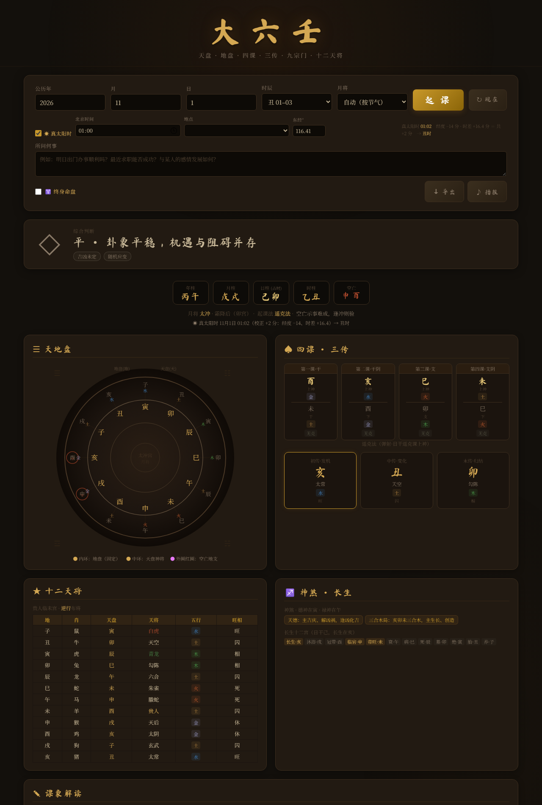

# 大六壬在线占卜

基于中国传统六壬术的在线起课工具，支持完整的九宗门算法。



## 功能

- 🌟 **四柱八字** — 年、月、日、时干支自动推算（儒略日法，非查表）
- ☀️ **真太阳时校正** — 按当地经度 + 时差方程定时辰，含 37 个主要城市；新疆西藏等地可纠正近 2 小时时差
- 🌙 **月将换将** — 内嵌 1900–2100 年节气精确时刻表（北京时，精确到分），按中气**交节时刻**换将
- 🎛️ **手动指定月将** — 换将规则有流派差异时可手动覆盖，默认按节气自动推定
- 📅 **年柱月柱交节** — 年柱以立春分界、月柱以节分界，不再是按公历月粗略取整
- 🔄 **天盘排列** — 月将加时法
- 📖 **四课推导** — 干上神、支上神递推，日干按天干五行论克
- 🎯 **三传计算** — 九宗门全覆盖（贼克、比用、涉害、遥克、昴星、伏吟、反吟、别责、八专）
- ⚔️ **天将排盘** — 贵人起法完整，昼贵/夜贵、顺逆布将
- 🔮 **神煞系统** — 德神、禄神、驿马、桃花等
- 📊 **长生十二宫** — 阴阳干顺逆分途
- 📝 **详细解读** — 吉凶评分、五行生克、六亲、应期方位

## 使用

本地：直接用浏览器打开 `index.html`（仓库内唯一的正式版本）。

在线：<https://santeb.github.io/daliuren/>

起课时填「公历年月日 + 北京时间 + 地点」，默认按**当地真太阳时**定时辰（可在界面关闭）。
若只想按北京时间起课，取消勾选「☀ 真太阳时」，直接选时辰即可。

## 回归测试

算法改动后务必跑一遍（GitHub Actions 也会在 push 时自动跑这两个）：

```bash
node test.js     # 算法层回归，108 项断言
node smoke.js    # DOM 冒烟，真实走一遍起课流程
```

`test.js` 从 `index.html` 中抽取页面真正运行的那份 `<script>` 在 Node 里执行，覆盖 16 组共 108 项断言：

| 组 | 内容 |
|---|---|
| 1–3 | 日柱（对照独立实现）、年月柱（五虎遁）、时柱（五鼠遁 120 组） |
| 4–6 | 月将换将、天盘（全年 × 12 时辰共 4032 局）、空亡（60 甲子逐日） |
| 7 | 九宗门覆盖度：确认九门均可达，不再是死代码 |
| 8 | 十二天将排布无重复、贵人落位 |
| 9–10 | 六亲、长生十二宫、禄神、德神 |
| 11 | 古籍课例三传逐字比对 |
| 12 | 解读层遍历所有问题类型 × 多课，确认不抛异常 |
| 13 | 节气表（1900–2100，含时分）+ 年柱/月柱交节分界 |
| 14 | 手动指定月将开关（12 种均生效且天盘同步） |
| 15 | 真太阳时校正（时差方程全年极值、1440 分钟逐分时辰归属、换时辰/换日、跨月跨年） |
| 16 | 九宗门古籍课例：元首/比用/涉害/见机/察微/复等共 8 课三传逐字比对 + 古法重数独立复算 + 720 课全格课数守护（含涉害 82 课守恒） |

### 真太阳时（第 15 组）

占时默认按**当地真太阳时**定时辰，这是六壬起课里最容易忽略、也最容易错的一环：

```
真太阳时 = 北京时间 + 经度差（每度 4 分钟） + 时差方程 E
```

`E`（真太阳 − 平太阳）由地球轨道偏心与黄赤交角所致，全年在 **−14 ~ +16 分钟**之间波动，用 Spencer(1971) 近似式，误差 < 0.5 分钟。

实测影响：

| 输入（北京时间） | 地点 | 真太阳时 | 时辰 |
|---|---|---|---|
| 2026-07-10 12:00 | 乌鲁木齐（87.62°E） | 09:45 | 巳（不是午） |
| 2026-07-10 00:30 | 喀什（75.99°E） | 前一日 21:29 | 亥（**换日**） |
| 2026-07-10 23:30 | 北京（116.41°E） | 23:10 | 子（晚子时归次日） |

界面上可关闭该校正（关则直接用北京时间），也可手动填经度。

> 第 12 组是为拦截 `genAdvice()` 内误用未定义变量这类问题加的——曾经问感情类问题必然抛
> `lessons is not defined`，只跑算法层测试发现不了。

### DOM 冒烟（smoke.js）

`test.js` 只测算法层，不触发任何 UI 流程。`smoke.js` 在最小 DOM 桩上真实跑 `divine()`：

- 真太阳时开/关、手动月将、终身命盘等 6 条起课路径
- 10 类问题全部走完一遍（感情类曾必崩，现已被覆盖）
- 天地盘 canvas 绘制代码也会真正执行（用 2d 上下文桩，不走 skip 分支）

### 古籍课例（第 11 组）

四个课例均取自典籍，四课与三传逐一核对：

| 课例 | 课体 | 四课 | 三传 |
|---|---|---|---|
| 甲子日 戌将寅时 | 重审 | 戌甲 / 午戌 / 申子 / 辰申 | 戌午寅 |
| 丁丑日 申将子时 | 元首 | 卯丁 / 亥卯 / 酉丑 / 巳酉 | 巳丑酉 |
| 丙戌日 子将酉时 | 重审 | 丙申 / 申亥 / 戌丑 / 丑辰 | 申亥寅 |
| 壬辰日 辰将巳时 | 比用 | 壬戌 / 戌酉 / 辰卯 / 卯寅 | 戌酉申 |

### 九宗门课例（第 16 组）

八课起课参数完整，三传与典籍逐字比对通过：

| 课例 | 出处 | 课格 | 三传 |
|---|---|---|---|
| 壬戌日 酉将子时 | 《六壬粹言》 | 元首 | 巳寅亥 |
| 甲戌日 巳将子时 | 《六壬粹言》 | 比用（阳日阳比） | 子巳戌 |
| 辛卯日 辰将申时 | 《六壬粹言》 | 比用（阴日阴比） | 未卯亥 |
| 庚子日 戌将子时 | 《六壬大全·订讹》 | 涉害（两派同归） | 午辰寅 |
| 丁卯日 戌将子时 | 《粹言》正文 / 《订讹》 | 涉害·察微 ／ 古法取亥 | 丑亥酉 ／ 亥酉未 |
| 癸未日 辰将子时 | 《六壬粹言》 | 见机 | 酉丑巳 |
| 庚辰日 午将辰时 | 《六壬粹言》 | 察微 | 申戌子 |
| 戊辰日 未将子时 | 《六壬粹言》 | 复等 | 子未寅 |

《粹言》复等课后另注「此外又有戊辰、戊戌日返吟两课」，本实现此二课发用并为亥。
丁卯日一行即「古法 / 时法」两派分歧之所在，详见下节，本实现取丑。

### 720 课课数对照

九宗门 720 课（60 甲子 × 12 位移）实测分布，与《六壬粹言》所记课数逐格对照：

| 格 | 本实现 | 《粹言》记 | 备注 |
|---|---|---|---|
| 元首 | 127 | 120 | 别本作「一上克下名元首，计一百二十七」，与之合 |
| 重审 | 254 | 256 | 差 2 |
| 比用 | 97 | 95 | 差 2 |
| 见机 | 54 | 53 | 差 1 |
| 察微 | 25 | 26 | 差 1 |
| 复等 | 3 | 3 | ✔ |
| 遥克 | 72 | — | |
| 昴星 | 16 | — | |
| 别责 | 9 | — | |
| 八专 | 9 | — | |
| 伏吟（无克） | 48 | — | 另有 12 课伏吟盘有克，已按取用法归类 |
| 反吟（无克） | 6 | — | 另有 54 课反吟盘有克，已按取用法归类 |

**统计口径（关键）**：伏吟、反吟是**课体**不是取用法，盘中有克者仍须按取用法归类，只有无克者才单列。若一律剔除，重审会少 38 课、比用少 14 课——这正是此前对不上古籍数字的原因。

### 涉害法：时法（孟仲取用）与古法（数深浅）

《六壬粹言》卷二对涉害法给了**两套**取用法，且明确分了古今：

**正文「见机在孟察微仲」**（时法）：

> 谓阳日上用一阳，今则二阳三阳俱比矣……则以涉害之法取之。涉者渡也，害者克也。**先取孟位上乘神为和，曰见机。如孟位无以，则取仲位上乘神为用，曰察微（无取季位上神）。**

三格各记课数：见机 53、察微 26、复等 3。三例（癸未取酉、庚辰取申、戊辰取子）**全部直接按孟仲取，一句未提数深浅**。

**卷末按语**（古法）：

> 按涉害之法，取克贼之神，从地盘历数归于本家，以受克深者为用……如涉害俱深，则取孟位上神为用，孟位无以则取仲位上神为用，**则古法也，近来诸家皆无用之**，附近志于此，以见其原委如此云。

判据是课数。同一批 82 课涉害课，两种取用法的分格结果：

| 格 | 时法（本实现） | 古法 | 《粹言》记 |
|---|---|---|---|
| 见机 | 54 | 11 | 53 |
| 察微 | 25 | 9 | 26 |
| 复等 | 3 | 0 | 3 |
| **三格合计** | **82** | **20** | **82** |

时法下三格合计 82，与 53+26+3 精确守恒，复等恰 3 课；古法下三格合计仅 20 课，差之甚远。**故本实现从《粹言》正文之时法（纯孟仲取用），不数重数。**

代价是丁卯日一例：

- 时法：三课丑加卯（仲位）、四课亥加丑（季位），孟上无取，取仲上神丑 → 三传 **丑亥酉**（察微）
- 古法：亥加丑历辰、戊、未、己、戌五重土，丑加卯历乙木一重，五重 > 一重，取亥 → 三传 **亥酉未**（《订讹》与《粹言》按语皆主此）

两者不可兼得。取用说明中会附注「古法历归本家 N 重」，两派可随时对照；若要改用古法取用，把 `takeKe()` 中孟仲分支替换为按 `keCount()` 取最深者即可。

至于古法重数本身的算法，诸书还有两个开关各分两派：

| 开关 | 甲派 | 乙派 |
|---|---|---|
| 起点（上神所临之位）计不计 | 计入 | 不计 |
| 沿途地支的寄宫藏干算不算 | 算 | 不算 |

- 《六壬大全·订讹》演算最完整：庚子日「午加庚前行历**酉辛金**二重」「戌加子前行历**癸水**一重」，丁卯日「亥加丑历**辰、戊、未、己、戌**土五重」——既计寄宫，起点又不计。**本实现依此。**
- 《大六壬探源》甲辰日例「连同**甲木寅木**，其为四重害」则把起点连同其寄宫一并计入。

此二开关只影响「几重害」这一附注数字，不影响时法排出的盘。

## 算法要点

几处容易写错、已在此实现中订正的地方：

- **天盘**：月将加占时，顺布十二支；必须满足 `heavenMap[占时位] === 月将`。
- **第一课论克**：下神是日干，用天干五行，不能用寄宫地支五行（乙寄辰、丁寄未、戊寄巳、辛寄戌、癸寄丑，二者并不一致）。
- **取用通则**：「凡取克为用，不论上克下、下克上，皆取上一字」。
- **比用**：取**上神**与日干阴阳相比者（阳日取阳神子寅辰午申戌，阴日取阴神丑卯巳未酉亥）。
- **除上克不用**：四课中上克下与下贼上并见时，上克下之课一律剔除，只就下贼上取用。《粹言》甲戌日例：一课未甲、二课子未、三课卯戌皆下贼上，四课申卯上克下「不用」。少了这条，甲戌日会错取申（三传申丑午）而非子（子巳戌）。
- **四课不备先去重**：干上神与支阴神相同时（如壬午日巳将子时，一课四课皆辰加亥），同一课若当作两个候选，孟仲比较必判「并列」，复等格会虚高到 45 课以上。故有克诸课按「上神+下神位」先去重——去重后涉害课总数恒为 82 课，与古籍 53+26+3 精确守恒，这是该处理正确的最硬证据。
- **涉害取孟仲（时法）**：与日干俱比（或俱不比）而无可独取者，依《粹言》正文——先取地盘四孟上神曰见机，孟上无存取四仲上神曰察微，季位不取；俱在孟位者曰复等，取四课先见者。**不数重数**；「历归本家数重害」是原书按语所存古法，明言「近来诸家皆无用之」，本实现只把它作为附注数字保留。
- **涉害重数的方向**（仅供附注）：上克下数「沿途被上神所克」者，下贼上数「沿途克上神」者，二者方向相反。每地盘位取本气与所寄天干各一项（巳位计丙火、戊土；未位计丁火、己土）。
- **课数与课体分开统计**：伏吟、反吟是课体，盘中有克者仍按取用法归类（720 课中占 66 课），只有无克者单列。否则重审少 38 课、比用少 14 课，与古籍数字对不上。
- **空亡**：须按 60 甲子序号定旬，只用日干不足以定旬。
- **时柱**：五鼠遁，甲己还加甲 / 乙庚丙作初 / 丙辛从戊起 / 丁壬庚子居 / 戊癸壬子真。
- **课体优先于取法**：伏吟、反吟、八专、别责是课体，需先判课体，再按有无克走贼克 → 比用 → 涉害 → 遥克 → 昴星。
- **节气**：不用平均日期。内嵌 1900–2100 年 24 节气**精确时刻**（寿星天文算法生成，北京时间，精确到分），表外年份自动回退平均日期。交节当天按时刻分界——如 2026 年冬至在 12/22 04:51，此前（寅将）此后（丑将）月将不同。
- **年柱/月柱**：年以立春分界（2026-02-03 仍属乙巳年），月以「节」分界（小寒起丑月、立春起寅月 … 大雪起子月），月干依该月所属年干取五虎遁。
- **占时**：默认按当地真太阳时（经度差 4 分/度 + 时差方程），可关闭。新疆、西藏与北京时差可达 2 小时，不校正会错一个时辰。
- **子时换日**：晚子时（23:00–24:00）归次日，早子时（00:00–01:00）属当日。

## 技术

纯前端实现，单文件 HTML，无依赖（节气表约 29 KB 直接内嵌，不联网取数据）。字体为异步加载，Google Fonts 不可达时回退系统字体，不阻塞首屏。

节气表由 `gen_jieqi.js`（工作区根目录，依赖 `lunar-javascript`）生成后写入 HTML，需要重新生成时执行 `node gen_jieqi.js`。

> **历史版本说明**：此前仓库内还有 `daliuren.html`（早期简化版）与 `daliuren_full.html`。两者与 `index.html` 同源但已分叉，且存在天盘方向、空亡、时柱等错误，会给出错误排盘，现已删除。`index.html` 是唯一受支持的版本。

## License

[MIT](./LICENSE) © 2026 santeb

可自由使用、修改、二次分发，也可商用；唯一要求是在副本中保留上述版权声明与许可声明。
软件按「原样」提供，作者不承担任何担保与责任。
